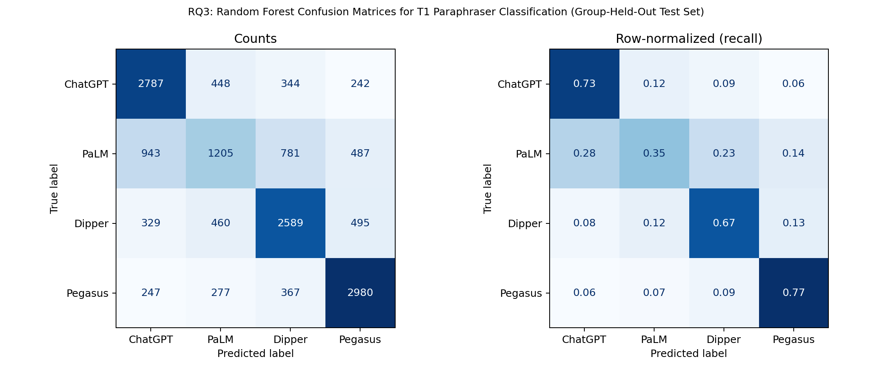
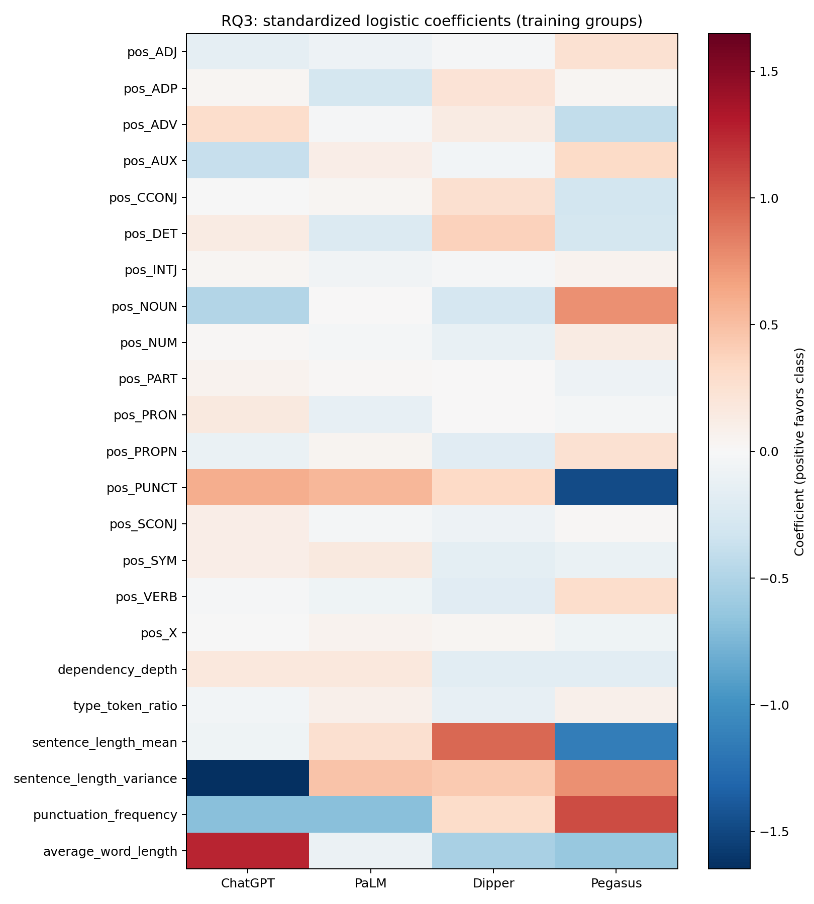

# RQ3 — Initial Paraphraser Fingerprint Classification

## Design

Classify the **first paraphrase (T1)** as ChatGPT, PaLM, Dipper, or Pegasus. Pegasus uses only Pegasus(full); Dipper(low/high) and Pegasus(slight) are excluded. T0 is not assigned a paraphraser label. This experiment uses all seven datasets and Human plus six LLM original sources in the existing complete-T0–T3-chain feature table. Selection therefore depends on chain completeness, not merely T1 availability.

There are 74,643 T1 records. Split unique **group_id** values 80/20 with seed 42, stratified by dataset. There are 2,416 training groups (59,662 rows) and 604 test groups (14,981 rows); group overlap is **0**. group_id = dataset::key keeps different source versions and all paraphraser outputs for the same key together. The split assignments are exported for auditing.

Both models use only 17 POS proportions and six style/syntax features. Dataset, key, group_id, source and paraphraser identifiers are excluded from predictors. Median imputation (20 missing feature cells in the full selected sample) and logistic standardization are fitted on training rows only. Logistic regression uses class_weight=balanced, max_iter=2000. Random forest uses 200 trees, min_samples_leaf=3, class_weight=balanced. Hyperparameters are fixed in advance; both models are reported without test-set tuning.

## Held-out results

| Model | Accuracy | Macro F1 |
|---|---:|---:|
| majority_baseline | 0.2585 | 0.1027 |
| logistic_regression | 0.5912 | 0.5776 |
| random_forest | 0.6382 | 0.6225 |

The majority baseline is fitted on the training labels. Random forest has the higher observed score of the two prespecified classifiers. This is a single group-held-out evaluation, not a cross-validation or external-dataset estimate.

## Random-forest confusion matrix

Rows are true labels; columns are predictions.

| True / Predicted | ChatGPT | PaLM | Dipper | Pegasus |
|---|---:|---:|---:|---:|
| ChatGPT | 2787 | 448 | 344 | 242 |
| PaLM | 943 | 1205 | 781 | 487 |
| Dipper | 329 | 460 | 2589 | 495 |
| Pegasus | 247 | 277 | 367 | 2980 |



Pegasus has the highest recall (0.7698), followed by ChatGPT (0.7294), Dipper (0.6685), and PaLM (0.3528). PaLM is therefore the weakest class. Per-class precision/F1 and dataset/source subgroup results are exported alongside the predictions.

## Preliminary distinguishing features

The following are the four largest positive coefficients for each class in the standardized multinomial logistic model. They indicate conditional associations with that class, relative to competing classes; they explain the logistic model, not the random forest.

- **ChatGPT**: `average_word_length` (+1.258), `pos_PUNCT` (+0.601), `pos_ADV` (+0.285), `dependency_depth` (+0.178).
- **PaLM**: `pos_PUNCT` (+0.546), `sentence_length_variance` (+0.466), `sentence_length_mean` (+0.268), `dependency_depth` (+0.170).
- **Dipper**: `sentence_length_mean` (+0.948), `sentence_length_variance` (+0.430), `pos_DET` (+0.375), `pos_PUNCT` (+0.327).
- **Pegasus**: `punctuation_frequency` (+1.076), `pos_NOUN` (+0.760), `sentence_length_variance` (+0.753), `pos_AUX` (+0.315).



POS proportions are compositional and several punctuation/style measures are correlated, so coefficient rankings and signs should be treated as exploratory. Train-only feature means and all signed coefficients are provided for inspection. The evidence supports distinguishable stylistic traces in this sample, not unique or causal fingerprints.

## Limitations

- Only T1 is evaluated; this does not establish persistence through T2/T3.
- Group separation is verified for the supplied dataset::key identifiers. It does not prove that independently keyed duplicate texts or related content across datasets are absent.
- Complete-chain filtering, unequal class availability, source imbalance, and domain composition may affect results. Test accuracy is a pooled row-level measure, with correlated records within groups; no confidence intervals are claimed.
- No tuning or external-domain validation is performed. Feature extraction quality depends on the existing preprocessing and POS parser.

## Reproduce

```bash
python -m src.paraphraser_fingerprint
python -m tests.test_paraphraser_fingerprint
```

Inputs: data/processed/update2_features.pkl. Tables: data/results/update2/rq3_*.csv and rq3_summary.json. Figures: figures/update2/rq3_*.png. The checks cover group isolation across source/paraphraser/stage variants, reproducibility, invalid identifiers/duplicates and the four-class macro metric. After installing the missing lexical-metric dependencies, the complete test suite was run with `python3 -m pytest -q`: **23 passed in 1.34s**, including all three RQ3 checks.
